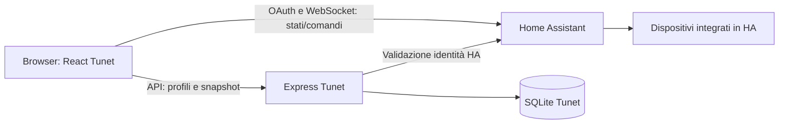

# REP-20261005-005 — Audit della struttura Tunet

| Campo | Valore |
|---|---|
| ID / incarico | REP-20261005-005 |
| Stato | Completato |
| Data | 2026-10-05, Europe/Rome |
| Autore / modello | Codex; nome esatto del modello non disponibile |
| Commit di partenza | 14ff7f4ca6f00677f16eefb699fc95224795c9a9 |
| Richiesta di riferimento | «Analizza la struttura di Tunet come applicativo, perché è fatto con IA, va verificato se segue i miei principi di programmazione di frontend come prima cosa, mi dici come è realizzata e io ti dico come l'infrastruttura deve essere» |
| Autorizzazione | Analisi di struttura, flussi, qualità e verifiche disponibili; documentazione dei risultati. L'utente definirà l'infrastruttura dopo l'analisi. |

## Obiettivo e perimetro

Ricostruire il funzionamento di Tunet 1.22.1, revisione upstream 5dec99587b4fcc2fb1f831a0a0002c9b90e6958e, e valutarne organizzazione frontend, stato, accessi HA, stile e test. Confrontare con i principi umani documentati; richiesto all'utente il riferimento alle ulteriori convenzioni frontend. La documentazione upstream costituisce una fonte da verificare sul codice, non una regola ACA né un'approvazione delle sue autovalutazioni.

Git inizialmente pulito. Sorgenti, dipendenze, container applicativi e configurazione HA da preservare. Sono ammessi controlli in un ambiente isolato con il lockfile esistente; nessun refactor, correzione applicativa, cambio dello stack o scelta della futura infrastruttura. L'origine IA è dichiarata dall'utente; non si deduce la qualità dall'autore o da indicatori stilistici.

## Criteri di completamento

- Mappa verificabile delle responsabilità, entry point, componenti, stato, servizi e persistenza.
- Punti solidi e limiti collegati a codice/configurazioni concrete; osservazioni distinte da proposte.
- Esiti reali dei controlli disponibili, senza equiparare test simulati a collaudo dell'impianto.
- Confronto con i principi già confermati e dichiarazione dei criteri mancanti; decisioni infrastrutturali lasciate all'utente.
- Diff documentale e integrità dei sorgenti verificati; report e indice aggiornati.

## Avanzamento e modifiche

Nessun grafo Graphify preesistente nel repository; analisi diretta dei sorgenti e dei riferimenti. Nessuna dipendenza aggiunta per generare un grafo. Ricevuti i principi frontend dell'utente; fonte e ambito in [ADR-0004](../decisions/ADR-0004-principi-frontend.md). L'ADR registra i criteri umani e non avvia una migrazione.

## Come è realizzato Tunet

### Stack e organizzazione

Versioni effettive dal [lockfile](../../progetto/tunet/package-lock.json): React/React DOM 19.2.8, Vite 8.2.2, Tailwind CSS 4.3.3, home-assistant-js-websocket 9.6.0; backend Express 5.2.1 e better-sqlite3 13.0.3. Frontend SPA nel browser, backend Node separato per configurazioni/profili. Sorgenti prevalentemente JS/JSX: due file con estensione .ts (utils/logger.ts e la dichiarazione types/global.d.ts), nessun TSX. [dashboard.js](../../progetto/tunet/src/types/dashboard.js) espone typedef JSDoc; non è una codebase prevalentemente TypeScript.

| Area | Responsabilità verificata | Riferimento |
|---|---|---|
| Entry point | StrictMode, ErrorBoundary, provider, router hash, service worker | [main.jsx](../../progetto/tunet/src/main.jsx) |
| Coordinamento applicativo | Collega configurazione, pagine, entità, hook, modali e view model | [App.jsx](../../progetto/tunet/src/App.jsx) |
| Stato | Configurazione/aspetto, pagine/card, HA, stato UI, modali e notifiche | [contexts](../../progetto/tunet/src/contexts/index.js) |
| Hook | Connessione, griglia, temi, profili, sincronizzazione e interazioni | [hooks](../../progetto/tunet/src/hooks/index.js) |
| Servizi frontend | Comandi/storico HA, OAuth, header autenticati, API profili/settings | [haClient.js](../../progetto/tunet/src/services/haClient.js), [profileApi.js](../../progetto/tunet/src/services/profileApi.js) |
| UI condivisa | Slider, dropdown, picker, shell modali, immagini, toast | [M3Slider.jsx](../../progetto/tunet/src/components/ui/M3Slider.jsx), [AccessibleModalShell.jsx](../../progetto/tunet/src/components/ui/AccessibleModalShell.jsx) |
| Interfacce di dominio | Card per dispositivi, pagine tematiche e modali | [LightCard.jsx](../../progetto/tunet/src/components/cards/LightCard.jsx), [LightsPage.jsx](../../progetto/tunet/src/components/pages/LightsPage.jsx), [LightModal.jsx](../../progetto/tunet/src/modals/LightModal.jsx) |
| Rendering/layout applicativo | Registry delle card, dispatch, modali lazy, struttura dashboard | [registry.js](../../progetto/tunet/src/rendering/registry.js), [DashboardLayout.jsx](../../progetto/tunet/src/layouts/DashboardLayout.jsx) |
| Stile | CSS variables/temi, Tailwind e CSS globale, stili inline nelle interfacce | [themes.js](../../progetto/tunet/src/config/themes.js), [index.css](../../progetto/tunet/src/styles/index.css) |
| Backend | Asset compilati e API di profili, snapshot/settings e icone | [server/index.js](../../progetto/tunet/server/index.js), [db.js](../../progetto/tunet/server/db.js) |

L'organizzazione attuale raggruppa soprattutto per tipo tecnico (cards, pages, modals, hooks, services), con alcune estrazioni locali come modals/editCard. Non coincide con una struttura in cui ogni pagina contiene i propri componenti e compone prevalentemente una libreria completa di primitive.

### Flussi e persistenza

I comandi ai dispositivi non passano necessariamente dal backend Tunet: il browser usa la connessione HA direttamente. Express valida l'identità HA per le API protette di dati Tunet. Profili/settings sono associati all'identità autenticata; questo non dimostra i ruoli condominiali ACA.

ConfigContext/PageContext persistono molte preferenze nel browser. OAuth/sessione e snapshot temporanei delle entità hanno meccanismi di cache nel browser. useSettingsSync/settingsApi collegano snapshot per utente/device a SQLite con revisioni e gestione del conflitto 409. Conservazione e privacy del prodotto richiedono il loro progetto; non è stata letta la cache autenticata del browser.

### Dimensioni misurate

Conteggio diretto dei file src/server, con split sulle nuove righe (include la riga finale vuota): 322 file JS/JSX/TS, 82.386 righe complessive. Escludendo __tests__: 231 file e 67.693 righe; 90 file .test.* e 14.691 righe, più setup test. Non è una misura automatica della qualità.

- App.jsx: circa 965 righe, coordinamento di molte configurazioni/azioni.
- EditCardModal.jsx: circa 3.240 righe; VacuumModal.jsx circa 2.800; ConfigModal.jsx circa 2.427; StatusPillsConfigModal.jsx circa 2.410.
- LightCard riceve entità e numerose callback/configurazioni; useAppViewModels e ModalOrchestrator mantengono un'ampia superficie di parametri. Le estrazioni esistono, ma non eliminano l'accoppiamento dell'orchestrazione.

## Confronto con i principi dell'utente

| Principio confermato | Stato Tunet | Evidenza / valutazione |
|---|---|---|
| Primitive condivise per componenti base | Parziale | components/ui include controlli riusabili; manca una libreria uniforme Button/Card/Container usata prevalentemente dalle interfacce. Card di dominio diverse definiscono direttamente struttura e stile. |
| Primitive tipografiche | Disallineato | Titoli, paragrafi e span vengono definiti direttamente nelle interfacce, con classi/style locali; non è presente un gruppo di primitive tipografiche condivise. |
| Primitive di layout | Disallineato | layouts contiene la struttura della dashboard e rendering la griglia applicativa; non sono equivalenti a primitive generiche Grid/Flex/Stack utilizzate sistematicamente. |
| Pagine composte principalmente dalle primitive | Disallineato | LightsPage, modali e card mescolano markup, stile, stato e azioni di dominio. I widget esistenti sono riutilizzabili ma non soddisfano da soli la composizione richiesta. |
| Componenti specifici organizzati per pagina | Parziale | Alcune sezioni estratte in modals/editCard; molte card/modali/hook risiedono invece in directory generali per tipo tecnico. |

Riscontro statico indicativo, non parser JSX: almeno un tag nativo button in 75 file di produzione, div in 103, p in 67, span in 77, h2 in 15, h1 in 3. L'HTML nativo resta corretto dentro una primitiva: questi conteggi mostrano la distribuzione del markup, non un divieto assoluto di usarlo.

**Valutazione:** base funzionale con parti riutilizzabili e verifiche concrete; organizzazione da adattare ai principi ACA prima di una personalizzazione estesa. Non è necessario dedurre una riscrittura integrale: il patrimonio HA, sincronizzazione e test può essere valutato separatamente dal nuovo livello visivo. Strategia e incarico di migrazione restano da stabilire.

## Aspetti solidi e limiti

**Aspetti solidi verificati:** separazione frontend/backend e presenza di servizi/hook; registry delle card; caricamento lazy delle modali; ErrorBoundary globale/per card; shell modali con focus/Escape/Tab; gestione reduced motion; separazione tra entità e metadata HA, batching con requestAnimationFrame; selettori useSyncExternalStore per le modali; controllo revisioni/snapshot e test backend.

**Limiti osservati:**

1. Strato di primitive incompleto rispetto ai criteri umani; la variazione grafica richiederebbe oggi interventi distribuiti in molte interfacce.
2. File di grandi dimensioni e ampio coordinamento/prop passing; la sola suddivisione in cartelle non dimostra responsabilità ridotte o indipendenza delle pagine.
3. [Typecheck](../../progetto/tunet/tsconfig.typecheck.json) con checkJs ma strict/noImplicitAny disattivati, varie annotazioni any. Il successo del comando non equivale a contratti fortemente tipizzati; l'utente non ha imposto TypeScript, quindi è un limite da valutare, non una violazione di una sua regola.
4. Luminosità con politiche diverse: LightCard applica debounce 200 ms, rimandando l'invio durante un gesto continuo; LightModal chiama il servizio direttamente a ogni onChange (M3Slider raggruppa per frame, range dei sottodispositivi usa onChange nativo). Non è una policy unica di invii durante il gesto/conferma HA; la microinterazione ACA sull'icona resta da realizzare.
5. React.memo è presente ma varie card ricevono l'intera mappa entities, la cui referenza cambia con gli aggiornamenti. Possibili render ampi, non un problema prestazionale dimostrato: manca un profilo sul carico/hardware del pilota.
6. Service worker: shell e asset già richiesti possono essere in cache; non pre-carica tutti i chunk lazy né rende locali font/risorse esterne. Le prove offline restano da eseguire (ISSUE-016).
7. Documentazione per agenti upstream non interamente aggiornata: copilot-instructions parla ancora di React 18 e di un'immagine hassen-app:latest, mentre il lockfile è React 19 e il banco prova usa Compose ACA. Source immutata; AGENTS radice/stato ACA restano le regole applicabili.
8. PIN impostazioni gestito nel frontend/local storage: è un blocco dell'interfaccia, non implementazione dei permessi admin/cliente/condominio su HA. UI e autorizzazioni effettive devono essere valutate separatamente.

Non vengono attribuite queste caratteristiche alla generazione IA senza evidenza. L'autovalutazione 8.1/10 nella guida Copilot non è stata usata come risultato dell'audit.

## Verifiche ed evidenze

| Controllo | Procedura | Esito | Limiti |
|---|---|---|---|
| Stato iniziale | git status --short; lettura di AGENTS/stato/template | Superato | Git pulito, incarico precedente completato. |
| AUD-01 | Lettura di manifest/lockfile, sorgenti/configurazioni e conteggio Node | Superato | Mappa e confronto sopra riportati; analisi statica ragionata, non revisione di ogni riga o prova di origine IA. |
| AUD-02 | docker build --target builder -t aca-tunet-audit:5dec995 progetto/tunet | Superato | Ambiente isolato, Dockerfile/lockfile esistenti. Immagine audit locale; applicazione esistente non ricreata. |
| AUD-03 | docker run --rm --network none aca-tunet-audit:5dec995 npm run lint -- --format json | Superato | Exit 0; 222 file controllati, 0 errori/0 warning. La configurazione ESLint esclude i test e non controlla il backend. |
| AUD-04 | docker run --rm --network none aca-tunet-audit:5dec995 npm run typecheck | Superato | Exit 0; checkJs con strict/noImplicitAny false, test esclusi. |
| AUD-05 | docker run --rm --network none -e CI=1 aca-tunet-audit:5dec995 npm test | Superato | 90 file / 705 test passati. Ambiente isolato jsdom/test backend, nessuna rete o volume HA/Tunet reale; non sono prove sui dispositivi. |
| AUD-06 | Nel medesimo ambiente: npm run lint:theme-colors; node scripts/check-bundle-size.mjs | Superato | Exit 0 per entrambi; colori verificati su 43 file secondo le regole upstream, chunk nei budget upstream. Non dimostra coerenza completa ACA né fluidità su Raspberry/tablet. |
| AUD-07 | E2E Playwright, copertura, profilazione, WAN assente e audit sicurezza completo | Non eseguito | Nessun collaudo completo di prodotto dichiarato. |
| AUD-08 | Integrità/diff/collegamenti | Superato | 407 sorgenti identici al manifest, 20 file storici protetti invariati, 33 documenti / 279 collegamenti locali validi; diff limitato agli otto documenti dell'audit. |

Log dei controlli in backup/tunet-audit-20261005, esclusi da Git. Il flag CI=1 configura soltanto i test temporanei: nessuna CI ACA attivata. Il builder usa il Dockerfile che esegue build con SKIP_POSTBUILD=1; nessun deploy implicito da postbuild. I container audit sono effimeri, privi di rete esterna e di mount ai dati reali. L'immagine audit rimane disponibile localmente per ripetere i controlli.

## Controllo del diff e decisioni

Solo documentazione dell'audit e registrazione dei principi umani in ADR-0004, con rimando nelle regole/architettura. Le criticità sono proposte da gestire nei futuri incarichi, non refactor applicati. Nessuna autovalutazione upstream assunta come evidenza di qualità o conformità; nessuna scelta della futura infrastruttura approvata dall'agente.

## Chiusura e punto di ripresa

Restituzione: Tunet è funzionante e supera i controlli eseguiti; segue solo parzialmente la composizione frontend richiesta. I principi umani sono registrati; l'utente indicherà ora la futura infrastruttura/organizzazione concreta. Refactor, librerie, migrazione, controlli fisici e nuovo deployment richiedono il relativo incarico. Audit chiuso dopo il controllo documentale finale; nessun incarico applicativo aperto da questo report.
