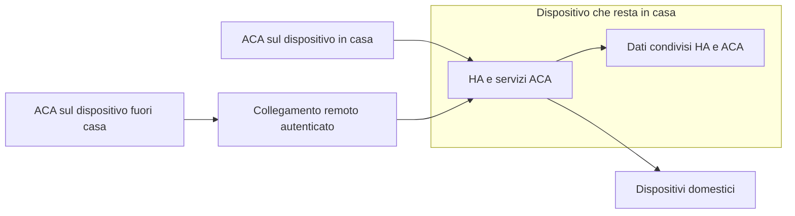

# Blocco 1 Dati ACA su più dispositivi e accesso fuori casa

Aggiornato: 2026-10-30. Fonte umana: [U21](../diario/2026-10-30.md#u21-dati-su-ogni-dispositivo-e-controllo-fuori-casa). [Ingresso](../README.md), [report](../../reports/REP-20261030-005-dati-multidispositivo-remoto.md).

**Seguito del 2026-10-30:** [U22, rete ACA e ruolo del master](01-rete-aca-discovery-master.md) valuta la proposta umana tablet domestico/mini PC opzionale, ricerca LAN e appoggio ai nodi di casa. Distinti cambio del percorso e trasferimento del motore HA; nessuna elezione o architettura approvata.

Per ritrovare la stessa casa su più dispositivi, la proposta più semplice è **una sola istanza domestica autorevole di HA e dei dati ACA, con più client autenticati**. L'accesso remoto aggiunge un percorso verso quella casa. Non occorre duplicare HA o la VM su ogni telefono; farlo creerebbe installazioni e database distinti.

La scelta non è ancora approvata. Restano da decidere dati comuni/personali, identità, collegamento remoto e disponibilità richiesta al dispositivo domestico. Nessun servizio, account o collegamento è stato attivato.

## Due esigenze diverse

| Esigenza | Soluzione da progettare |
|---|---|
| Stessi dispositivi e automazioni su telefono e computer | Tutti i client interrogano la stessa istanza HA. |
| Stesso profilo, layout e impostazioni ACA | Archivio autorevole comune, con ambito casa/utente/terminale esplicito. |
| Controllo fuori dalla LAN | Collegamento autenticato verso HA e le API ACA necessarie. |
| Consultazione con hub non raggiungibile | Eventuale copia/cache con data di aggiornamento; non stato corrente garantito. |
| Recupero dopo perdita dell'hub | Backup e ripristino, distinti da sincronizzazione e accesso remoto. |

Una VPN risolve la raggiungibilità, non rende comuni due database indipendenti. Un account cloud può identificare la casa e autorizzare dispositivi, ma non è da solo una replica di configurazioni, immagini, cronologia o automazioni.

## Dove resterebbe il motore

Nel modello proposto il PC Windows con la VM, oppure il tablet che supera le verifiche Android, assume il ruolo di hub. Gli altri terminali installano ACA come client della stessa casa; non devono ripetere il provisioning completo del motore.

Il collegamento può usare VPN, servizi remoti esistenti o un relay ACA da progettare. Il diagramma non afferma che ogni servizio remoto esponga già tutte le API ACA.

Per il comando di dispositivi locali l'hub deve restare a casa, acceso, operativo e collegato alla rete. Il telefono personale che esce di casa non può essere assunto come unico motore della LAN rimasta a casa. PC spento/sospeso, VM arrestata o Internet domestico assente impediscono il comando remoto; un relay non riaccende implicitamente il PC né esegue al suo posto le integrazioni locali.

Se nessun dispositivo può restare operativo in casa, occorre valutare un motore altrove e la raggiungibilità dei dispositivi: servizi dei produttori o un collegamento permanente verso la LAN. È un'altra architettura, non ottenibile salvando soltanto i profili nel cloud. Non viene adottata qui.

## Dati già presenti nei sorgenti

GitHub distribuisce il frontend; non è l'archivio dei dati personali dell'impianto.

| Tipo di dato | Collocazione attuale osservata |
|---|---|
| Entità, stati, servizi e cronologia | HA; il frontend si sottoscrive agli aggiornamenti e invia richieste. |
| Profili ACA | SQLite del server ACA, associati all'utente HA. |
| Impostazioni correnti e storico | Database ACA, per coppia utente HA / identità del terminale. |
| Casa 3D e immagini | Database del server ACA, con casa default per installazione. |
| Layout e varie impostazioni operative | Storage browser, trasferibile parzialmente tramite snapshot/profili. |
| Aspetto Kit 2 e foto di sfondo | Preferenze locali; la foto è in IndexedDB ed esclusa dalla sincronizzazione. |
| Token e sessioni | Client separati; esclusi intenzionalmente dagli snapshot. |

Evidenze: [database.ts](../../../progetto/acasystem/backend/src/models/database.ts), [snapshot.ts](../../../progetto/acasystem/frontend/src/api/snapshot.ts), [appearance.ts](../../../progetto/acasystem/frontend/src/utils/appearance.ts), [HomeAssistantContext.tsx](../../../progetto/acasystem/frontend/src/hooks/context/HomeAssistantContext.tsx), [haClient.ts](../../../progetto/acasystem/frontend/src/api/haClient.ts).

La condivisione è già **parziale**, non un risultato completo da rifare da zero né una sincronizzazione totale già pronta. Ogni browser genera tunet_device_id; il flusso corrente può salvare profili e pubblicare impostazioni su altri terminali dello stesso utente. Un nuovo dispositivo non riceve automaticamente ogni dato personale. [useSettingsSync.ts](../../../progetto/acasystem/frontend/src/hooks/useSettingsSync.ts), [settingsService.ts](../../../progetto/acasystem/backend/src/services/settingsService.ts).

Le revisioni non equivalgono a fusione generale: nel caso di conflitto il frontend può ritentare lo snapshot locale con la revisione aggiornata, mentre publish sovrascrive le copie destinatarie conservando lo storico. La futura esperienza dovrà scegliere cosa è comune, personale o specifico del terminale e come trattare modifiche concorrenti. La “memoria per dispositivo domotico” non va confusa con l'identità del telefono/computer su cui gira ACA.

## Condivisione proposta senza duplicare il database

La proposta conserva HA come fonte della domotica e un archivio ACA autorevole per le configurazioni proprie. Le preferenze che devono seguire la persona sono associate al suo utente; quelle legate a schermo, permessi e terminale restano locali se deciso esplicitamente.

Un nuovo client dovrebbe autenticarsi, essere associato alla casa e scaricare configurazione/versione compatibili. Le modifiche dovrebbero avere revisioni e regole di conflitto esplicite, senza trattare la copia locale appena avviata come più autorevole di quella della casa.

Non si propone di sincronizzare il file SQLite aperto o i VDI fra telefoni. Un backup può recuperare un guasto ma non risolve una modifica simultanea. Password, refresh token e identità del terminale non vanno clonati dentro un profilo condiviso.

Alla riconnessione il client deve rileggere lo stato corrente e ristabilire le sottoscrizioni. Una cache va presentata come ultima copia nota; non bisogna far apparire riuscito un comando che l'hub non ha ricevuto. Un'eventuale coda di comandi differiti sarebbe una scelta ulteriore, non il comportamento implicito di questo studio.

## Tre percorsi per l'accesso remoto

HA documenta Home Assistant Cloud di Nabu Casa, VPN e reverse proxy come possibilità di accesso esterno. L'esistenza di un URL remoto non sposta il motore o i dati nel cloud. [Accesso remoto HA](https://www.home-assistant.io/docs/configuration/remote/).

| Percorso | Cosa offre | Lavoro residuo per ACA |
|---|---|---|
| Nabu Casa / Home Assistant Cloud | URL HTTPS e tunnel verso la stessa istanza HA, senza port forwarding manuale sul router. | Raggiungere anche i dati/API ACA e soddisfare il vincolo di login/interfaccia ACA. |
| VPN, per esempio Tailscale | Collegamento privato verso servizi domestici autorizzati, anche server ACA se correttamente instradato. | Client VPN, associazione dispositivi, rete VM e supporto degli indirizzi nel client ACA. |
| Relay cloud ACA | Proposta di ingresso unico per account/dispositivi e tunnel uscente dell'hub. | Nuovo servizio da costruire e gestire, con disponibilità, costi e autorizzazioni propri. |

### Nabu Casa

Nabu Casa documenta un relay TCP: il traffico TLS viene inoltrato alla stessa istanza domestica, che lo decifra e lo tratta nel componente HTTP. La chiave privata resta locale. Per questo un frontend personalizzato può tecnicamente usare API REST/WebSocket senza aprire la dashboard; è una deduzione dal percorso HTTP, da provare su ACA. Il servizio non replica la casa sui client. [Funzionamento remoto](https://support.nabucasa.com/hc/en-us/articles/25619268678557-Remote-access-Deep-dive), [cifratura](https://support.nabucasa.com/hc/en-us/articles/26508882007581-Remote-access-Security-aspects).

Il tunnel non espone automaticamente il server ACA sulla porta 3002. Nabu Casa supporta gli add-on predisposti per Ingress; il [pacchetto ACA attuale](../../../progetto/ha-app/repository/acasystem/config.yaml) ha ingress false. Un adattamento Ingress/proxy o altro accesso deve essere progettato con sessioni, autorizzazioni, percorsi e WebSocket. Non basta attivare il cloud. [Contratto Ingress](https://contributors.home-assistant.io/apps/guides/ingress/).

L'account Nabu Casa riguarda il servizio remoto; l'utente HA autorizza l'accesso alla casa. Il limite documentato è per installazione HA, non per telefono: creare un HA indipendente su ogni client non produce una sincronizzazione usando lo stesso account cloud. [Limite multi-installazione](https://support.nabucasa.com/hc/en-us/articles/26178633145885-Can-I-use-a-single-account-for-multiple-Home-Assistant-installations).

### VPN

La VPN rende raggiungibile l'hub senza trasformare le configurazioni locali in dati sincronizzati. Tailscale documenta collegamenti diretti e relay quando il NAT impedisce il percorso diretto. NAT/CGNAT non sono risolti assumendo un IP pubblico fisso; restano necessari connettività e traffico uscente consentiti. [Connessioni Tailscale](https://tailscale.com/docs/reference/connection-types).

Il client VPN e le autorizzazioni di rete non sostituiscono utenti e permessi applicativi. Una VPN sul PC non rende automaticamente raggiungibile ogni servizio della VM: vanno verificati indirizzi, ascolto e instradamento. La semplice integrazione HA Tailscale monitora la rete e non installa il collegamento remoto al suo posto. [Integrazione HA](https://www.home-assistant.io/integrations/tailscale/).

Una prova VPN può essere utile per separare la verifica della casa condivisa dal futuro servizio remoto di prodotto. Non è una scelta già approvata e non garantisce l'esperienza “solo ACA” se richiede un'altra app e passaggi manuali.

### Eventuale relay ACA

Per una futura esperienza “accedo ad ACA e ritrovo la casa”, la proposta è un account/associazione remota e un tunnel iniziato dall'hub verso il servizio. I client autorizzati raggiungono quel collegamento; non vengono aperte automaticamente porte del router.

Il servizio potrebbe conservare identità e associazioni, lasciando domotica e configurazioni sull'hub. Spostare anche profili, immagini o copie dei dati nel cloud è una scelta distinta. HTTPS da solo non dimostra che il relay non possa leggere i contenuti: il modello di cifratura e gestione delle chiavi va definito prima di promettere proprietà specifiche.

Un account ACA globale non emerge dal percorso attuale; creare questo servizio introdurrebbe sviluppo, operazioni, costi e vincoli di dati da valutare. Non è autorizzato alcun provider, contratto, deploy o abbonamento.

## Identità e vincolo della UI HA nascosta

HA prevede più sessioni e token distinti per client. La proposta è autorizzare ogni dispositivo separatamente, con possibilità di revocarlo senza copiare le credenziali del primo telefono. Persone diverse devono conservare le rispettive autorizzazioni. [Autenticazione HA](https://contributors.home-assistant.io/core/internals/auth-api/).

Il percorso OAuth documentato apre l'autorizzazione HA. Questo non soddisfa automaticamente il vincolo umano “senza mostrare HA”, nemmeno se la UI operativa è ACA. Per mantenere quel vincolo anche al login servono flow ACA completi, inclusi MFA e recupero, oppure un modello di identità distinto progettato e autorizzato. Non si introduce una schermata HA come fallback approvato e non si aggira la MFA.

Il backend corrente valida il token presso il HA configurato sul server e associa l'utente a quel contesto. Un eventuale account ACA remoto non può trasformare tutti i client in amministratori o usare una sola credenziale globale per tutte le case. [Middleware corrente](../../../progetto/acasystem/backend/src/middlewares/homeAssistantAuth.ts).

## Che cosa manca oggi al collegamento dei client

Il [contratto del client installato](../../../progetto/client/core/src/config.ts) accetta IPv4 private RFC1918 e loopback, ricostruendo un'origine HTTP. Non accetta DNS, HTTPS configurabile, IPv6, IP pubblici o gli indirizzi 100.64/10 tipici di Tailscale. Una VPN verso una subnet privata potrebbe conservare un indirizzo ammesso, ma va provata: non si dichiara che l'accesso remoto sia già operativo.

Il frontend web usa invece percorsi relativi per [API ACA](../../../progetto/acasystem/frontend/src/api/backendClient.ts) e [proxy HA](../../../progetto/acasystem/frontend/src/api/haUrl.ts). Non è corretto attribuire a tutto il frontend un divieto HTTPS. Il futuro ingresso remoto deve conservare entrambi i percorsi e gestire WebSocket, autenticazione e origine del browser, non pubblicare soltanto HA.

Il passaggio LAN/remoto dovrebbe riferirsi alla stessa identità della casa e alla stessa sessione autorizzata, con stato offline esplicito. Nessuna scansione del primo HA disponibile o copia indiscriminata dei token può sostituire l'associazione.

## Porta effettiva HA e rettifica del provisioning

La ricerca corrente ha verificato che da 2026.8 le nuove installazioni HA OS usano normalmente porta 80; configurazioni migrate possono conservare 8123 e Container mantiene 8123. Nel tag Core 2026.10.4 il default dipende dal contesto Supervisor ed è modificabile da configurazione/SETUP_PORT. Il provisioning deve quindi rilevare e conservare la porta effettiva. [HTTP HA](https://www.home-assistant.io/integrations/http/), [default nel codice](https://github.com/home-assistant/core/blob/2026.10.4/homeassistant/components/http/config.py).

Nello studio U20 è stata rettificata la precedente indicazione fissa 8123 come destinazione del guest; nel report chiuso è aggiunta un'annotazione datata. Non è stata modificata alcuna porta o configurazione reale.

## Verifiche future e punto di ripresa

Tutte le prove sono **NON ESEGUITE**:

| Prova proposta | Evidenza richiesta |
|---|---|
| Due client sulla stessa casa | Stato HA comune e profili ACA caricati correttamente, senza secondo motore. |
| Nuovo terminale | Associazione, dati comuni/personali/locali e credenziale propria; nessuna perdita di configurazioni. |
| Modifiche contemporanee | Conflitto gestito secondo regole scelte, senza falsa dichiarazione di fusione. |
| LAN verso rete cellulare e ritorno | Stessa casa, autorizzazioni e WebSocket riconnessi; API ACA oltre a HA effettivamente raggiunte. |
| Revoca dispositivo e account con MFA | Accesso negato correttamente e login conforme al vincolo UI scelto. |
| Hub, VM o Internet domestico non disponibili | Stato offline e dati datati riconoscibili; nessun comando dichiarato eseguito senza conferma. |
| Riavvio e ripristino | Identità, profili e dati recuperati; backup distinto dal collegamento remoto. |

Per la discussione successiva la raccomandazione è separare **hub domestico e client**, definire quali dati seguono l'utente e confrontare il trasporto remoto. Un cloud ACA completo non è necessario solo per leggere gli stessi dati da un hub raggiungibile; può diventare una scelta di prodotto per rendere associazione e accesso trasparenti.

Analisi completata, nessuna architettura remota approvata, attivazione, installazione, modifica al codice/configurazione o prova. Pin/materiali precedenti invariati; percorso tecnico iOS ancora rinviato.

