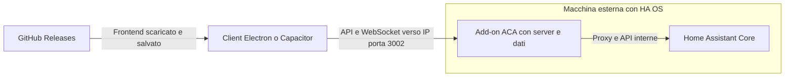

# Blocco 1 Installazione ACA

**Approfondimento successivo 2026-10-30:** [ACA e HA sullo stesso PC Windows](01-windows-electron-ha-locale.md), con Electron come unica interfaccia e motore Linux locale allo studio. Non modifica lo stato del codice ricostruito qui né approva installazioni o porting.

Aggiornato: 2026-10-29. Analisi in sola lettura dei sorgenti correnti, dei pacchetti locali e del repository pubblico configurato. Richiesta umana: [U3 nel diario](../diario/2026-10-29.md#u3-blocco-1-installazione-aca). Controlli e limiti: [REP-20261029-005](../../reports/REP-20261029-005-blocco1-installazione-stato-attuale.md).

## Idea descritta dall'utente

Un'app per telefono o computer, con due gusci Capacitor ed Electron, collegata tramite IP a una macchina esterna con Home Assistant OS. ACA viene installato su quella macchina come add-on; il frontend arriva da GitHub. Questa descrizione è il punto di partenza della discussione, non l'approvazione di una nuova implementazione.

## Struttura effettiva

L'impianto descritto esiste nei sorgenti. I componenti principali sono tre: il client sul dispositivo, un server ACA sul mini PC e Home Assistant. Electron e Capacitor sono gusci nativi dell'applicazione, non due container Docker.

| Componente | Responsabilità osservata | Evidenza nei sorgenti |
|---|---|---|
| Windows | Guscio Electron con configurazione, installazione e avvio del frontend scaricato. | [main.ts](../../../progetto/client/windows/src/main.ts), righe 103-116. |
| Android | Guscio Capacitor per configurazione e installazione; frontend operativo in una WebView separata. | [UiActivity.java](../../../progetto/client/android/android/app/src/main/java/it/acasystem/client/UiActivity.java), righe 25 e 98. |
| Nucleo dei due client | Configurazione della macchina, controllo del server, download e compatibilità delle release, cache, installazione dell'add-on. | [startup.ts](../../../progetto/client/core/src/startup.ts), righe 81-139; [setup.ts](../../../progetto/client/core/src/setup.ts), righe 60-82 e 270-344. |
| Server ACA | Server Node/Express con API proprie e database; inoltra HTTP e WebSocket a HA sotto `/ha`. | [server.ts](../../../progetto/acasystem/backend/src/server.ts), righe 69-103. |
| Pacchetto per HA OS | Immagine `ghcr.io/acamemo/acasystem`, porta 3002, avvio automatico, watchdog; catalogo predisposto per `amd64`, con Ingress disabilitato. | [config.yaml](../../../progetto/ha-app/repository/acasystem/config.yaml), righe 8-26. |

L'IP serve a raggiungere il server ACA. Il frontend dei client installati viene invece scaricato da GitHub e aperto sul dispositivo tramite un piccolo server locale, normalmente `http://127.0.0.1:47320`. Quest'ultimo serve i file dell'interfaccia e inoltra `/api` e `/ha` al server remoto. Evidenze: [server locale Windows](../../../progetto/client/windows/src/localServer.ts), righe 55-63; [avvio Windows](../../../progetto/client/windows/src/main.ts), righe 115-116; [avvio Android](../../../progetto/client/android/android/app/src/main/java/it/acasystem/client/UiActivity.java), riga 98.

Il server sulla macchina esterna contiene anche una propria copia del frontend e della Casa 3D, servita in produzione: il [Dockerfile](../../../progetto/acasystem/Dockerfile), righe 35-37, include entrambi i bundle. Esistono quindi sia il percorso dei client con frontend da GitHub, sia l'accesso web al frontend incorporato nel server. Sono percorsi che possono utilizzare versioni diverse dell'interfaccia.

## Installazione e primo avvio

Il client non si limita ad aprire un indirizzo. Il flusso implementato in `core/src/setup.ts` è:

1. Chiedere l'IP della macchina e verificare ACA sulla porta configurata, predefinita 3002.
2. Se ACA non risponde, cercare HA sullo stesso IP, sulle porte 8123 e 80.
3. Distinguere un HA da configurare da uno già configurato; offrire creazione del proprietario o accesso amministratore.
4. Completare i dati della casa e i passi di configurazione iniziale mancanti.
5. Aggiungere il repository ACA al Supervisor, installare l'add-on se manca e avviarlo, impostando avvio automatico e watchdog.
6. Attendere `/api/health` del server ACA; poi avviare il frontend scaricato da GitHub o già in cache.

Il percorso di installazione presuppone HA OS con Supervisor e una sessione amministratore; il codice del login di installazione non gestisce MFA. Non installa HA OS sul disco di una macchina vuota: parte da una macchina dove HA è già disponibile. Riferimenti: [setup.ts](../../../progetto/client/core/src/setup.ts), righe 60, 130, 154-180 e 299-343.

La configurazione attuale accetta IPv4 privati o loopback e costruisce un URL HTTP. Nomi DNS, IPv6 e configurazione HTTPS non sono gestiti dal contratto del client. Evidenza: [config.ts](../../../progetto/client/core/src/config.ts), righe 18-56.

## Frontend e aggiornamenti

Il nucleo dei client legge le GitHub Releases pubbliche di `acamemo/acasystem-releases`. Controlla versione minima del server e del guscio, dimensione e SHA-256 del bundle, poi lo salva sul dispositivo. Il controllo degli aggiornamenti del frontend avviene all'avvio.

Se GitHub non è disponibile, può avviare un bundle compatibile già in cache. Il server ACA deve comunque rispondere: questa possibilità riguarda l'assenza di connessione a GitHub, non il funzionamento senza la macchina esterna. Evidenza: [startup.ts](../../../progetto/client/core/src/startup.ts), righe 85-104 e 128-139.

Frontend, server e guscio hanno versioni e percorsi di aggiornamento separati. Nei sorgenti esaminati non risulta un aggiornamento automatico dei binari Electron o APK; la configurazione Windows ha `publish: null` ([package.json](../../../progetto/client/windows/package.json), riga 54). Il client può segnalare che il server o il guscio sono troppo vecchi per una UI, cercando una release compatibile.

## Sorgenti e distribuzione osservati

Verifica remota del 2026-10-29, tramite il plugin GitHub e lettura HTTPS del manifest pubblicato:

| Elemento | Stato osservato |
|---|---|
| Repository di distribuzione | [acamemo/acasystem-releases](https://github.com/acamemo/acasystem-releases), pubblico, ramo predefinito `main`. |
| Ultima release indicata da GitHub | [v0.9.30](https://github.com/acamemo/acasystem-releases/releases/tag/v0.9.30), pubblicata il 2026-10-26; contiene ZIP frontend, `manifest.json` e ZIP sorgenti. Nessun APK o pacchetto Windows negli asset di questa release. |
| Manifest pubblicato | [manifest.json](https://github.com/acamemo/acasystem-releases/releases/download/v0.9.30/manifest.json): UI 0.9.30, server minimo 0.9.30, guscio minimo 0.1.0. |
| Catalogo HA OS pubblicato | [config.yaml](https://github.com/acamemo/acasystem-releases/blob/main/acasystem/config.yaml), blob `e8f38a7b019ca8714ac093b81eb01a44fc0d8c05`: versione add-on 0.9.30.1, solo `amd64`, `homeassistant_api: false`. |
| Template HA OS nei sorgenti correnti | Versione da sostituire in preparazione, `homeassistant_api: true`, richiesto dal codice recente per l'autogestione dell'identità di servizio. Il template locale differisce dal catalogo pubblico. |
| Client nei sorgenti | Versione dichiarata 0.1.0 per Windows e Android. Sono presenti ZIP Windows e APK locali; non ne è stata provata l'installazione o la corrispondenza ai sorgenti correnti. |
| Banco Docker configurato sul PC | `progetto/.env` seleziona 0.9.32; i Compose prevedono istanze separate di prova. È una configurazione, non la conferma di un servizio attivo. |

Non si può quindi identificare tutto il lavoro locale con la versione distribuita. La differenza del catalogo HA OS è accertata; il contenuto binario dell'immagine GHCR non è stato ispezionato in questa analisi.

## Prove e limiti

Il [report storico dell'installazione](../../reports/REP-20261026-005-configurazione-automatica-mini-pc.md), righe 321-335, registra una prova completa del 2026-10-26 sul Tab M11 e una VM HA OS: creazione del proprietario, installazione dell'add-on 0.9.30.1, apertura e accesso ad ACA. Il tablet passava via USB e inoltro dal PC; il report dichiara non provati Wi-Fi diretta, interruzioni a ogni passo e Dell.

Queste prove non sono state ripetute ora. Il controllo `docker ps` sul PC non è riuscito perché il motore Docker Desktop non risponde; non è stato avviato. Non è stato verificato lo stato attuale di VM o macchine esterne, né sono stati eseguiti test, build o installazioni. Le osservazioni descrivono implementazione e distribuzione leggibili, con i collaudi storici attribuiti al loro report.

## Discussione sulla doppia distribuzione del frontend

Domande umane successive: [U4 nel diario](../diario/2026-10-29.md#u4-semplificazione-del-frontend-e-backend-home-assistant). Analisi e fonti in [REP-20261029-006](../../reports/REP-20261029-006-discussione-frontend-backend-ha.md). Quanto segue distingue osservazioni e valutazioni, senza scegliere una nuova architettura.

La duplicazione riguarda la distribuzione degli stessi file dell'interfaccia, non due frontend sviluppati separatamente. Il server web esisteva prima dei gusci. Il [report dei client](../../reports/REP-20261026-002-app-client-pc-android.md), righe 295-297, registra che il server locale del guscio consentiva di lasciare invariati frontend e server ACA. Questa è la continuità documentata che spiega le route statiche rimaste nel server.

Oggi c'è anche una dipendenza concreta nella preparazione dei pacchetti: [make-release.ts](../../../progetto/client/scripts/make-release.ts), righe 19-20 e 53-57, estrae frontend e Casa 3D dall'immagine del server per creare lo ZIP destinato a GitHub. La copia incorporata nel server e il pacchetto client provengono quindi dalla stessa build al momento della preparazione della release.

I client non utilizzano il frontend remoto come ripiego: [startup.ts](../../../progetto/client/core/src/startup.ts), righe 85-139, seleziona una UI da GitHub o dalla cache. La doppia distribuzione non è un requisito per far funzionare questo percorso. La rimozione degli statici dal server comporterebbe invece la perdita dell'accesso web diretto e richiederebbe di adattare la preparazione delle release. Non basta cancellare la cartella della build.

Le alternative da discutere sono:

| Distribuzione principale | Semplificazione possibile | Conseguenze |
|---|---|---|
| Frontend solo nei client, scaricato da GitHub | Il server distribuito svolge solo le funzioni API e proxy ACA; mantiene l'obiettivo originale del download della UI. | Rinuncia al frontend web servito direttamente dal mini PC; separazione della produzione dei bundle dall'immagine server. Restano compatibilità UI/server e cache dei client. |
| Frontend solo sul server | I gusci aprono l'interfaccia del mini PC; un'unica versione della UI per quel sistema, senza distribuzione separata della UI ai client. | Cambia l'obiettivo del download del frontend da GitHub sul dispositivo. L'aggiornamento dell'interfaccia passa dalla distribuzione sul mini PC; i flussi di installazione nei gusci vanno comunque considerati. |

Valutazione dell'assistente: mantenendo l'obiettivo dichiarato del frontend da GitHub, la prima alternativa è coerente. Se prevale la semplicità complessiva di distribuzione, la seconda elimina più meccanismi dai client. Nessuna delle due alternative è stata selezionata dall'utente.

## Uso del backend Home Assistant

Home Assistant Core è già il motore domotico a cui ACA si collega. Core gestisce stati, integrazioni, automazioni e storico; su HA OS il Supervisor gestisce Core e le app. Core e HA OS non sono lo stesso componente. Fonte primaria consultata il 2026-10-29: [architettura ufficiale](https://contributors.home-assistant.io/architecture/big-picture/).

È possibile scaricare il [sorgente ufficiale di Core](https://github.com/home-assistant/core); la [guida di sviluppo](https://contributors.home-assistant.io/core/development/environment/) descrive come lavorarci. Eseguirne una copia invariata è diverso dal mantenere una variante modificata. Il solo repository Core non comprende l'intero sistema HA OS con Supervisor e gestione degli add-on. Fonti primarie consultate il 2026-10-29; nessun clone o ambiente Home Assistant creato in questo incarico.

Per usare il backend non è necessario copiarne il codice: la [WebSocket API ufficiale](https://contributors.home-assistant.io/core/internals/websocket-api/) è già usata dal frontend e dalle app di Home Assistant. Questo rende possibile un'interfaccia propria sul motore ufficiale, come nel collegamento attuale di ACA. Fonte primaria consultata il 2026-10-29.

Il servizio ACA corrente ha responsabilità aggiuntive: profili, impostazioni condivise, Casa 3D, gestione dei flussi dei dispositivi e proxy. Le sue route sono visibili in [server.ts](../../../progetto/acasystem/backend/src/server.ts), righe 69-103; i dati propri in [database.ts](../../../progetto/acasystem/backend/src/models/database.ts), righe 15-124. Scaricare Core non trasferisce automaticamente quei dati e contratti al backend HA.

Valutazione dell'assistente: conviene prima chiarire quali responsabilità ACA servono ancora e quali si possano eliminare o affidare alle API di HA. Una variante modificata di Core comporterebbe anche integrazione degli aggiornamenti upstream e verifica delle personalizzazioni: è un diverso impegno di manutenzione, da motivare con un'esigenza concreta. Non è necessario adottarla per avere un'interfaccia ACA sul backend Home Assistant.

## Punto di ripresa

Il chiarimento successivo dell'utente è **solo telefono/tablet, senza mini PC**. La [valutazione dedicata](01-valutazione-solo-telefono.md) approfondisce responsabilità ACA, Smart Life/Alexa e motore HA sul dispositivo; [U5 e U5a](../diario/2026-10-29.md#u5-funzioni-aca-e-modello-smart-life-o-alexa) conservano le fonti umane. Questo documento mantiene la ricostruzione precedente come riferimento. Cloud/offline, dispositivi supportati e motore restano da scegliere; nessuna modifica al codice assegnata.
