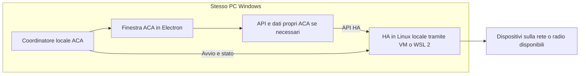

# Blocco 1 ACA Electron e HA sullo stesso PC Windows

**Approfondimento successivo 2026-10-30:** [installazione e gestione automatica HA OS VM](01-provisioning-vm-haos.md), su U20: procedura proposta senza Manager VirtualBox o UI HA, con materiali, identità, prerequisiti e recupero. Nessuna installazione o nuova soluzione adottata.

Aggiornato: 2026-10-30. Fonte umana: [U19](../diario/2026-10-30.md#u19-aca-e-ha-sullo-stesso-pc-windows). [Report](../../reports/REP-20261030-003-ha-locale-windows-electron.md), [ingresso](../README.md).

È plausibile offrire una sola esperienza ACA su Windows: un'icona, una finestra Electron normale e Home Assistant operativo sullo stesso PC, senza mostrarne la UI. La strada più solida emersa dallo studio mantiene HA in Linux locale. Includere Python per Windows nel pacchetto Electron non rende Core eseguibile nativamente.

La raccomandazione dell'assistente è usare **HA OS in una VM locale come riferimento iniziale**, confrontando poi una distribuzione WSL 2 dedicata se l'obiettivo di confezionamento richiede maggiore integrazione. Non è una scelta umana già adottata. Restano [app normale senza kiosk](../../decisions/ADR-0027-app-normale-senza-kiosk.md), [perimetro multipiattaforma](../../decisions/ADR-0028-obiettivi-multipiattaforma.md) e componente frontend HA presente ma non mostrato. Nessun ambiente è stato installato o avviato.

## Un'app per l'utente con componenti locali separati

La proposta distingue tre responsabilità: Electron presenta ACA; un coordinatore locale conosce stato e identità del motore; HA gira in un ambiente Linux sul PC. L'eventuale facciata ACA conserva soltanto le responsabilità ancora necessarie e i contratti richiesti dal frontend.

Il diagramma è una proposta di confini, non un nuovo server realizzato o un obbligo di introdurre tutti i processi separati. Una VM nello stesso PC non introduce un mini PC esterno. L'utente non deve aprire terminali, console VM o dashboard HA nell'uso ordinario; l'installazione iniziale può comunque richiedere componenti di sistema e privilegi, da progettare.

## Perché Python Windows non risolve l'avvio di Core

Nel tag fissato **Home Assistant Core 2026.10.4**:

| Riscontro nei sorgenti | Conseguenza per Windows nativo |
|---|---|
| `__main__.validate_os()` accetta piattaforme linux/darwin e rimanda Windows a WSL. | Il normale avvio Windows viene rifiutato. |
| `runner.py` importa `fcntl` incondizionatamente e usa il lock Unix della configurazione. | Il normale CPython Windows non fornisce il modulo richiesto. |
| `util/resource.py` importa `resource` e imposta limiti dei descrittori. | Ulteriore dipendenza da API Unix. |
| `helpers/signal.py` registra segnali con `loop.add_signal_handler()`. | Occorre adattare il ciclo di arresto/riavvio per un porting Windows. |

Fonti primarie: [avvio Core](https://github.com/home-assistant/core/blob/2026.10.4/homeassistant/__main__.py), [runner](https://github.com/home-assistant/core/blob/2026.10.4/homeassistant/runner.py), [resource HA](https://github.com/home-assistant/core/blob/2026.10.4/homeassistant/util/resource.py), [segnali HA](https://github.com/home-assistant/core/blob/2026.10.4/homeassistant/helpers/signal.py); [fcntl Python 3.14](https://docs.python.org/3.14/library/fcntl.html), [resource Python 3.14](https://docs.python.org/3.14/library/resource.html). Consultazione 2026-10-30.

L'opzione `--ignore-os-check` salta soltanto la guardia iniziale; non implementa i moduli mancanti. Un launcher personalizzato non dimostra risolte tutte le dipendenze o integrazioni. Non viene affermato che asyncio intero o ogni dipendenza Python siano Linux-only: i blocchi sono quelli effettivamente letti. Un porting rimane teoricamente valutabile ma richiederebbe codice e manutenzione propri, fuori da questo studio.

Restano HA 2026.10.4 e i pin orjson 3.11.9/cryptography 50.0.1. Python 3.14.10 della baseline soddisfa il minimo Core 3.14.2; questa compatibilità di versione non supera i vincoli del sistema operativo. [pyproject fissato](https://github.com/home-assistant/core/blob/2026.10.4/pyproject.toml). La distinta U11 del laboratorio Linux per il preflight Android non viene trasformata automaticamente in pacchetto di produzione Windows.

## Alternative per ospitare HA localmente

Il motore Core continua a esistere. È il metodo d'installazione diretto Core in ambiente Python, come quello Supervised, a non essere più supportato dall'upstream dopo 2025.12. I metodi documentati sono HA OS e HA Container; la guida Windows propone HA OS in VM. Il controllo nel codice che ammette WSL non rende nuovamente supportato il metodo Core/venv. [Annuncio HA](https://www.home-assistant.io/blog/2025/05/22/deprecating-core-and-supervised-installation-methods-and-32-bit-systems/).

| Soluzione | Vantaggio per ACA | Costi e limiti |
|---|---|---|
| HA OS in VM locale | Percorso HA documentato per Windows; comprende Supervisor e gestione dell'ambiente HA. | Hypervisor, disco virtuale, risorse, rete e avvio headless da integrare; non un solo eseguibile autosufficiente. |
| WSL 2 dedicato con Docker Engine Linux e HA Container | Usa l'immagine Linux HA senza porting di Core e può essere coordinato dal guscio Windows. | Host Windows/WSL e rete/radio richiedono collaudo specifico. Nessun Supervisor/add-on; non è il percorso Windows della guida HA. |
| WSL 2 con Core/Python diretto | Ambiente Linux controllabile senza un secondo desktop. | Metodo Core/venv fuori supporto upstream; ACA deve mantenere runtime, dipendenze e aggiornamenti. |
| CPython Windows nativo | Eviterebbe il livello Linux se il porting riuscisse. | Richiede adattamenti oltre al packaging; nessun funzionamento dimostrato e non consigliato come prima strada. |

La [guida Windows HA](https://www.home-assistant.io/installation/windows/) indica almeno 2 GB di RAM e 2 vCPU per la VM; sono risorse del guest, oltre al sistema Windows e a Electron. La stessa guida richiede rete appropriata e segnala l'assenza del normale supporto USB nel percorso Hyper-V. Non si deduce supporto di tutte le radio o integrazioni da una semplice API raggiungibile.

La [guida HA Container Linux](https://www.home-assistant.io/installation/linux/#install-home-assistant-container) richiede Docker Engine e dichiara che Docker Desktop non funziona per quella procedura. Pertanto Docker Desktop già presente sul PC non è una soluzione pronta per questo prodotto. Un Engine nel Linux WSL è un percorso differente, anch'esso da collaudare. Docker documenta oggi host networking Desktop con limiti, ma ciò non annulla il requisito HA. [Limiti host networking Docker](https://docs.docker.com/engine/network/drivers/host/#limitations).

## PC attuale osservato senza avviare ambienti

Lettura di proprietà selezionate con `Get-CimInstance Win32_OperatingSystem` e `Win32_ComputerSystem`:

| Proprietà | Valore osservato |
|---|---|
| Sistema | Microsoft Windows 11 Home |
| Versione / build | 10.0.26300 / 26300 |
| Architettura OS | 64 bit |
| Memoria fisica rilevata | 15,7 GiB |
| HypervisorPresent | true |

Questi dati identificano il possibile banco di prova, non dimostrano WSL 2, VM o HA funzionanti. Nessun inventario delle distribuzioni, avvio WSL/Docker/VM, accesso alla loro API o modifica del risparmio energetico. La precedente ricognizione U14 aveva rilevato la CLI Docker e wsl.exe, non un backend operativo.

WSL 2 è disponibile su Windows Home. Il ruolo Hyper-V completo richiede invece Pro/Enterprise e non può essere assunto disponibile solo perché `HypervisorPresent=true`. Per una prova HA OS su questo PC, VirtualBox è un candidato della guida HA, da verificare insieme alla virtualizzazione già attiva. Non si propone ora cambio di edizione Windows. [FAQ WSL](https://learn.microsoft.com/en-us/windows/wsl/faq#is-wsl-2-available-on-windows-10-home-and-windows-11-home), [requisiti Hyper-V](https://learn.microsoft.com/en-us/windows-server/virtualization/hyper-v/get-started/Install-Hyper-V#check-requirements-for-windows).

WSL non ancora predisposto o un hypervisor non disponibile possono richiedere installazione/abilitazione, amministratore e riavvio. Un futuro installer ACA dovrà riconoscere e spiegare questi prerequisiti; l'attuale installer per utente non li fornisce automaticamente. [Prerequisiti WSL](https://learn.microsoft.com/en-us/windows/wsl/install).

## Come apparirebbe l'apertura di ACA

Questa sequenza è proposta, non implementata:

1. L'utente apre l'icona ACA e vede subito una finestra ACA normale con il proprio stato di avvio.
2. Il coordinatore riconosce l'ambiente di sua proprietà. Se HA è già attivo si ricollega; altrimenti avvia VM o distribuzione locale senza console.
3. Attende disponibilità del motore, autenticazione e configurazione, distinguendo “processo partito” da “API pronte”.
4. Primo accesso e dati necessari sono raccolti dalle schermate ACA. I flussi da coprire richiedono una verifica completa, comprese integrazioni e autenticazioni particolari.
5. La UI usa API proprie ACA e API HA attraverso il percorso locale scelto. Nessuna navigazione automatica verso la dashboard HA.
6. Un secondo clic sull'icona riapre/focalizza ACA senza creare un secondo motore o usare due volte la stessa configurazione.

HA espone [REST](https://contributors.home-assistant.io/core/internals/rest-api/) e [WebSocket](https://contributors.home-assistant.io/core/internals/websocket-api/); questo consente una UI distinta, ma non garantisce che ogni schermata HA sia già sostituita. Il codice locale di setup contiene già parti di onboarding, mentre i [view di onboarding Core](https://github.com/home-assistant/core/blob/2026.10.4/homeassistant/components/onboarding/views.py) mostrano il contratto da seguire per la versione fissata. Non sono stati collaudati nuovi flussi.

La VM può essere avviata senza finestra tramite le API/CLI del relativo hypervisor: VirtualBox documenta `startvm --type headless`. Un comando Linux può essere indirizzato alla distribuzione WSL specifica. Il main Electron può invocare strumenti esterni con argomenti controllati e console nascosta, senza una shell generica; `utilityProcess` esegue codice Node e non sostituisce Python o un hypervisor. [VirtualBox 7.2](https://docs.oracle.com/en/virtualization/virtualbox/7.2/user/vboxmanage.html), [comandi WSL](https://learn.microsoft.com/en-us/windows/wsl/basic-commands), [processi Node](https://nodejs.org/api/child_process.html).

Non mostrare HA è una scelta del percorso utente, non il blocco tecnico delle sue route. Nessuna rimozione del frontend, modifica delle credenziali o apertura di nuove porte è stata assegnata.

## Che cosa succede alla chiusura

Per conservare automazioni a finestra chiusa bisogna distinguere la finestra dal motore. Due proposte diverse:

| Proposta | Esperienza | Limite |
|---|---|---|
| Coordinatore nella sessione utente, con icona nell'area notifiche | X chiude la finestra; “Apri ACA” la ricrea, un comando separato arresta il motore. | Dipende dalla sessione e dal coordinatore; non promette continuità dopo logout o prima del login. |
| Host del motore indipendente dalla UI, gestito dal sistema | Electron può terminare mentre HA continua. | Richiede progettare installazione, identità, dati e controllo del servizio/VM. Non è l'attuale installer per utente. |

Electron fornisce [Tray](https://www.electronjs.org/docs/latest/api/tray); Windows fornisce [servizi avviabili senza utente connesso](https://learn.microsoft.com/en-us/windows/win32/services/services). Un processo detached non è automaticamente un servizio. Le distribuzioni WSL sono per utente: un eventuale servizio con un'altra identità non eredita automaticamente la stessa distribuzione e gli stessi dati. Inoltre systemd non mantiene da solo viva l'istanza WSL. [Identità WSL](https://learn.microsoft.com/en-us/windows/wsl/setup/environment), [systemd WSL](https://learn.microsoft.com/en-us/windows/wsl/systemd).

Sono scelte ancora aperte: U17 richiede uscita normale e U16 studia la continuità, ma non approvano automaticamente un comportamento Tray o un servizio Windows. L'uscita completa dal programma e l'arresto del motore dovranno avere un significato visibile e coerente.

| Evento | Comportamento da verificare |
|---|---|
| X o riapertura della UI | Continuità prevista solo se il motore resta ospitato dal componente scelto. |
| Display spento / sessione bloccata | Può continuare se il PC resta operativo e con rete; non equivale a una prova sotto sospensione. |
| Logout | Il modello per utente non garantisce continuità; l'host indipendente richiede prova propria. |
| Sleep / ibernazione | Non garantiscono l'esecuzione continua di automazioni; al risveglio occorre recuperare connessioni e stato. |
| Spegnimento / riavvio | HA non lavora durante il fermo; avvio del motore prima/dopo login è un requisito da scegliere. |
| Crash / termine da Gestione attività | Recupero e intervallo di indisponibilità devono essere rilevati, senza promettere riavvio immediato. |

Electron distingue `prevent-app-suspension`, che permette il display spento, da `prevent-display-sleep`. Il primo è un candidato per la continuità richiesta, non un blocco universale di ogni arresto o sleep esplicito. Non va imposto lo schermo acceso. [powerSaveBlocker](https://www.electronjs.org/docs/latest/api/power-save-blocker), [stati energetici Windows](https://learn.microsoft.com/en-us/windows/win32/power/system-power-states).

Su Windows gli eventi Electron before-quit/will-quit/quit non sono emessi in tutti i casi di logout, spegnimento o riavvio. Non si può quindi affidare tutta la persistenza a will-quit. Anche terminare brutalmente il launcher non equivale ad arrestare gentilmente il motore Linux: occorre un protocollo di stop e attesa con l'host scelto. [Ciclo di vita Electron](https://www.electronjs.org/docs/latest/api/app#event-will-quit).

## Rete e hardware sono verifiche separate dalla UI

Per WSL, il percorso Windows verso un servizio Linux via localhost è previsto; il NAT non equivale però a collegare HA direttamente alla LAN. La modalità mirrored di Windows 11 22H2 e successivi aggiunge multicast e accesso LAN, con firewall e compatibilità da verificare. La configurazione globale WSL può interessare anche altre distribuzioni: non va cambiata automaticamente dal prototipo. Per HA OS VM, il bridge della guida è un candidato da provare sull'adattatore reale. [Rete WSL](https://learn.microsoft.com/en-us/windows/wsl/networking).

Una UI raggiungibile non dimostra discovery mDNS/SSDP, callback di dispositivi, Matter, BLE o Zigbee. L'USB richiede un percorso host-guest esplicito; WSL documenta usbipd-win con componenti aggiuntivi e condizioni di condivisione. Bluetooth Windows non diventa automaticamente BlueZ/D-Bus nel guest. [USB WSL](https://learn.microsoft.com/en-us/windows/wsl/connect-usb), [Bluetooth HA](https://www.home-assistant.io/integrations/bluetooth/).

La porta HA nel guest e quella del proxy Windows sono indirizzi differenti. Dove possibile l'app può esporre il solo punto locale di accesso ACA, ma il motore può richiedere rete LAN per le integrazioni. Non fissare un bind esclusivamente loopback senza verificare questi flussi; nemmeno aprire tutto il servizio in rete per il solo fatto che la VM usa un bridge. Individuazione del motore, collisioni di porta e autenticazione vanno provate.

## Dati aggiornamenti e confini ACA

Proposta: runtime e dati distinti, con configurazione/database HA sul filesystem Linux o sul disco persistente della VM, dati ACA nella posizione associata alla sua identità e cache UI separata. Un aggiornamento dell'app non deve sovrascrivere configurazioni o dipendere dalla directory d'installazione per conservarle.

Non basta copiare un database in uso o salvare soltanto la cache frontend. Prevedere backup coerenti, ripristino e migrazioni prima di provare aggiornamenti. In particolare, reinstallazione dell'app e rimozione della distribuzione/VM sono eventi distinti: nessuna pulizia automatica dei dati o comando globale di arresto WSL è autorizzato.

Le immagini HA OS/Container portano il proprio runtime: non sostituirlo implicitamente con la distinta host di preflight. Per una futura prova, fissare immagine/versione/digest e verificare Core 2026.10.4 e dipendenze effettive. Non sono selezionati oggi una release HA OS, una distribuzione di produzione, un hypervisor o nuovi pin.

Il frontend attuale parla con il server ACA, non soltanto con HA. Per una prima prova con meno cambiamenti è valutabile **HA OS VM con il server ACA nel suo add-on già previsto**, sullo stesso PC: conserverebbe inizialmente i contratti. Un'eventuale facciata locale ridotta e l'eliminazione di parti del server sono un passo diverso, da valutare sulle [responsabilità censite](01-valutazione-solo-telefono.md). Non basta cambiare l'origine da porta 3002 a 8123.

## Stato effettivo del client Windows

| Elemento letto | Riscontro |
|---|---|
| [package.json](../../../progetto/client/windows/package.json) | Electron 44.7.0, builder 26.17.0; NSIS per utente e ZIP x64, senza host HA incluso. |
| [main.ts](../../../progetto/client/windows/src/main.ts) | Finestra normale, contesto isolato e renderer senza Node; singleInstanceLock già presente. Chiudere tutte le finestre chiama app.quit(). |
| [localServer.ts](../../../progetto/client/windows/src/localServer.ts) | Proxy/static server 127.0.0.1:47320; inoltra /api e /ha verso il server ACA configurato. |
| [startup.ts](../../../progetto/client/core/src/startup.ts) | Richiede health del server ACA e compatibilità del bundle GitHub/cache. |
| [setup.ts](../../../progetto/client/core/src/setup.ts) | Interroga HA e Supervisor per installare/avviare l'add-on ACA, non crea VM o WSL. |
| [fileStore.ts](../../../progetto/client/windows/src/fileStore.ts) | Configurazione e bundle in userData; non è lo storage del motore HA locale. |

Non sono presenti nel flusso letto avvio di HA locale, Tray, installazione di servizio o gestione della VM. Il contratto corrente chiude il proxy in will-quit senza attenderlo. Nessun build, test Electron o avvio dell'app è stato eseguito nello studio.

## Piano futuro di fattibilità

Tutte le fasi sono **NON ESEGUITE** e sono proposte, non nuovi incarichi.

| Fase | Prova futura | Evidenza richiesta |
|---|---|---|
| W0 Perimetro | Scegliere HA OS VM o WSL, integrazioni campione, significato di X/Esci e attese dopo logout/boot. | Profilo esplicito, prerequisiti e dati da preservare. |
| W1 Host locale | In futuro ambiente isolato dal repository, motore fissato senza PC esterno. | Versione/digest, API pronta, dati persistenti; nessun port forwarding da backend remoto. |
| W2 Solo ACA | Onboarding e uso attraverso ACA, con host headless e caricamento ACA. | Nessuna UI HA necessaria nei flussi campione, nessuna console nell'uso ordinario. |
| W3 Dispositivi | Primo dispositivo Wi-Fi locale, comando confermato e automazioni a finestra chiusa; discovery distinta dall'indirizzo manuale. | Eventi/esiti registrati anche senza renderer aperto, con limiti delle integrazioni espliciti. |
| W4 Ciclo di vita | Riapertura, istanza doppia, display spento, sleep/risveglio, crash, logout e riavvio. | Nessun doppio HA, intervalli di fermo noti, recupero senza perdita dei dati selezionati. |
| W5 Dati e aggiornamenti | Backup/ripristino e aggiornamento su dati di prova. | Configurazioni e dati ACA/HA recuperabili, versioni coerenti e via di recupero provata. |
| W6 Uso prolungato | Prima 24-72 ore, poi estensione proposta a 7 giorni sul profilo scelto. | RAM/CPU/storage e automazioni misurati; esito limitato alle condizioni osservate. |

Il primo confronto utile è tra **HA OS VM come riferimento ufficiale** e **WSL 2 con Linux gestito da ACA come alternativa di prodotto**. La seconda opzione può integrare meglio il confezionamento, ma richiede di assumersi gestione del sottosistema e collaudo del suo ciclo di vita; non è dimostrato che sia più semplice o leggera per il carico finale.

## Esito e punto di ripresa

L'obiettivo di un'unica app visibile ACA sullo stesso PC è distinto dal porting nativo di HA. La proposta mantiene Electron e il motore Linux locale, senza mostrare il frontend HA. Non impone un dispositivo kiosk o un secondo computer.

Restano da scegliere host, comportamento di chiusura/continuità, integrazioni campione e responsabilità minime del server ACA. Lo studio non approva VM, WSL, servizi, nuovi permessi o installazioni. iOS resta rinviato. Analisi completata; nessun codice o configurazione modificati, nessuna prova runtime eseguita e pin/materiali precedenti invariati.

